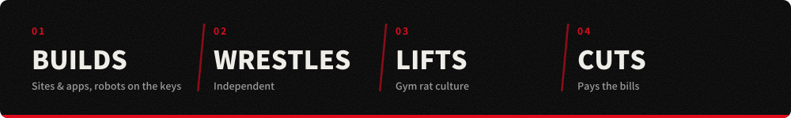
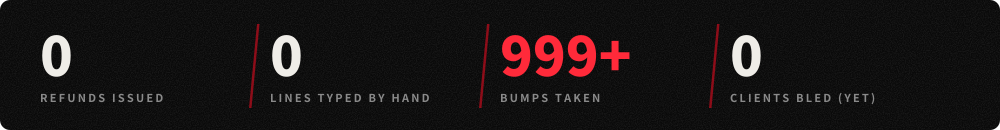

<p align="center">
  
</p>

<br/>

I'm Diogo. Portuguese, stubborn, and slightly too comfortable around sharp objects.

I cut hair, get thrown around rings for fun, and lift heavy things to stay angry in a productive way. Somewhere in between I build software, which is a generous way of saying I tell robots what to do and take the credit.

Yes, it works. No, I won't explain it.

Code isn't my personality. It's a tool, like clippers or a steel chair, and just as dangerous in the hands of a guy who thinks he knows what he's doing. Hi, that's me. It's why I'm building a barber booking system and a wrestling CV instead of yet another to-do app.

<p align="center"></p>

<p align="center">
  
</p>

<p align="center">
  
</p>

## In progress

My personal site, built with React and Next.js:

```text
diogosamuel.com
├── /             the main event
├── /barber       my availability + bookings, straight into the shop's app
└── /prowrestler  my CV, my matches, and how to hire me (or fear me)
```

One domain for every questionable decision I've made. Next: a workout tracking app. After that: the gym. After that: more questionable decisions.

## Tools

**Building with**

<p>
  
</p>

**Doing the typing (I just yell at them)**

<p>
  
  
  
  
  <!-- Falta uma ferramenta (a tua mensagem ficou cortada). Adiciona aqui. -->
</p>

**Back when I wrote it all by hand**

<p>
  
</p>

## Find me

Haircuts, bookings, collabs, websites. Not accepting opinions about wrestling being fake.

<p>
  <a href="https://instagram.com/diogosvmuel">
    
  </a>
  <a href="https://tiktok.com/@diogosvmuel">
    
  </a>
  <a href="https://github.com/diogosvmuel">
    
  </a>
  <!-- Descomenta quando o site estiver online:
  <a href="https://diogosamuel.com">
    
  </a>
  -->
</p>

<br/>

<p align="center">
  
</p>
